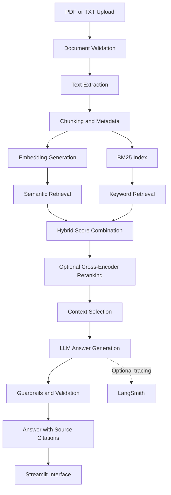

# 💹 Finance RAG Assistant | AI-Powered Financial Research

An end-to-end **Retrieval-Augmented Generation (RAG)** application that enables users to ask natural-language questions about financial reports and documents. Built with Python, semantic embeddings, BM25 keyword search, cross-encoder reranking, and LLMs, the assistant retrieves relevant passages and generates context-grounded answers with source citations.

<p align="center">
  <a href="https://financial-rag-projectgit-mehrafevet4cygzuycio2f.streamlit.app/">
    
  </a>
  <a href="https://github.com/TusharK93/Financial-Rag-Project">
    
  </a>
</p>

<p align="center">
  
  
  
  
  
</p>

---

## 📌 Table of Contents

- [Project Overview](#-project-overview)
- [Business Problem](#-business-problem)
- [Solution](#-solution)
- [Key Features](#-key-features)
- [System Architecture](#️-system-architecture)
- [Technology Stack](#️-technology-stack)
- [How It Works](#-how-it-works)
- [Hybrid Retrieval Strategy](#-hybrid-retrieval-strategy)
- [Evaluation and Impact](#-evaluation-and-impact)
- [Getting Started](#-getting-started)
- [Environment Configuration](#-environment-configuration)
- [Running the Application](#-running-the-application)
- [Deployment](#-deployment)
- [Troubleshooting](#-troubleshooting)
- [Security and Limitations](#️-security-and-limitations)
- [Future Improvements](#-future-improvements)
- [Author](#-author)

---

## 📌 Project Overview

Financial reports contain valuable information about revenue, expenses, profitability, business performance, risks, and market conditions. Extracting specific insights from lengthy documents can be time-consuming, particularly for small retailers and analysts who need to make decisions quickly.

The **Finance RAG Assistant** addresses this challenge by combining document retrieval with large language models (LLMs). Users can upload PDF or TXT documents, ask questions in natural language, and receive answers grounded in relevant document passages.

Instead of relying exclusively on an LLM's pretrained knowledge, the system retrieves information from the uploaded documents and uses that context to formulate responses. Source attribution helps users verify the information behind an answer.

The project demonstrates a complete RAG workflow, including document ingestion, text chunking, metadata handling, embeddings, hybrid search, reranking, answer generation, guardrails, observability, and cloud deployment.

## 🎯 Business Problem

Small retailers, business owners, and financial analysts often need to review lengthy financial documents to answer questions such as:

- How has revenue changed over a reporting period?
- What expenses or risks are highlighted in a report?
- Which financial indicators are discussed in the document?
- What key findings appear in a quarterly or annual report?
- Where in the source document can a particular claim be verified?

Manually locating relevant information takes time and can make research less efficient.

### Project Objectives

- Simplify natural-language querying of financial documents.
- Retrieve relevant information using both semantic and keyword search.
- Improve retrieval relevance with optional cross-encoder reranking.
- Generate answers grounded in retrieved context.
- Provide source citations, including page-level references where available.
- Monitor application behavior using structured logs and optional LangSmith tracing.
- Improve responsiveness and operational efficiency through caching, rate limiting, and token and latency optimization.

## 💡 Solution

The assistant implements a document-grounded question-answering workflow.

1. **Document ingestion:** Accept PDF and TXT files.
2. **Text extraction:** Extract readable text and preserve source metadata where available.
3. **Chunking:** Split the extracted content into smaller passages.
4. **Embedding generation:** Convert passages into semantic vector representations.
5. **Hybrid retrieval:** Combine semantic search with BM25 keyword retrieval.
6. **Reranking:** Optionally use a cross-encoder to refine the retrieved passages.
7. **Context preparation:** Select relevant passages and associated metadata.
8. **Answer generation:** Send the question and retrieved context to the configured LLM.
9. **Guardrail checks:** Apply configured validation to inputs, retrieved content, and generated answers.
10. **Source attribution:** Display supporting document references so users can verify the answer.

The system is designed to make financial information easier to search and understand while keeping answers connected to the provided source material.

## ✨ Key Features

- 📄 **PDF and TXT Ingestion:** Upload supported financial documents for analysis.
- ✂️ **Document Chunking:** Break long reports into manageable retrieval units.
- 🧠 **Semantic Search:** Find passages based on meaning rather than exact keyword matches.
- 🔎 **BM25 Keyword Search:** Retrieve passages using important words and phrases.
- 🔀 **Hybrid Retrieval:** Combine semantic and lexical relevance signals.
- 🎯 **Cross-Encoder Reranking:** Optionally rerank candidate passages to improve relevance.
- 💬 **Grounded Question Answering:** Generate responses using retrieved document context.
- 📑 **Source Citations:** Display supporting sources and page references when the extracted metadata makes them available.
- 🔌 **Multiple LLM Providers:** Support Groq and Google Gemini, subject to the configured implementation.
- 🛡️ **LLM Guardrails:** Validate inputs and outputs and reduce unsupported responses where implemented.
- 📊 **LangSmith Observability:** Trace and evaluate supported operations when instrumentation is configured.
- ⚡ **Performance Optimization:** Use caching, rate limiting, and token, latency, and cost optimizations where enabled.
- 📝 **Structured Logging:** Support troubleshooting and operational monitoring.
- ☁️ **Cloud Deployment:** Access the application through Streamlit Community Cloud.

## 🏗️ System Architecture



### Architecture Components

| Component | Responsibility |
|---|---|
| Document ingestion | Accepts and validates uploaded files. |
| Text processing | Extracts content, creates chunks, and associates metadata. |
| Embedding model | Represents document passages as vectors. |
| Semantic retriever | Finds passages that are semantically related to the question. |
| BM25 retriever | Finds passages matching relevant terms and phrases. |
| Hybrid ranker | Combines retrieval signals to prioritize candidate passages. |
| Cross-encoder reranker | Reassesses query-passage relevance for selected candidates. |
| LLM layer | Generates responses using the selected context. |
| Guardrails | Applies configured checks to reduce unsafe or unsupported behavior. |
| Observability | Supports tracing, evaluation, and debugging. |
| Streamlit frontend | Provides document upload and question-answering functionality. |

## 🛠️ Technology Stack

| Category | Technologies |
|---|---|
| Programming language | Python |
| Web interface | Streamlit |
| RAG architecture | Retrieval-Augmented Generation |
| Embeddings | Sentence Transformers |
| Keyword retrieval | BM25 |
| Semantic retrieval | Embedding-based vector similarity search |
| Reranking | Cross-encoder reranker |
| LLM providers | Groq, Google Gemini |
| RAG framework | LlamaIndex where integrated |
| Observability | LangSmith |
| Document processing | PDF/TXT extraction libraries, depending on implementation |
| Deployment | Streamlit Community Cloud |
| Version control | Git, GitHub |

The exact dependencies, model identifiers, vector storage implementation, and optional integrations should match the current repository configuration.

## 🔄 How It Works

### 1. Document Ingestion

Users upload financial reports in supported PDF or TXT formats. The application validates the files before processing them.

### 2. Text Extraction and Metadata

The system extracts readable text and associates it with metadata such as the document name, chunk identifier, and page number when available.

Preserving metadata helps the application identify where retrieved information originated.

### 3. Chunking

Long documents are divided into smaller passages. Chunk size and overlap influence retrieval quality: very large chunks may introduce irrelevant information, while very small chunks may lose important context.

### 4. Embedding Generation

A Sentence Transformers embedding model converts text passages into numerical vectors. These vectors allow the system to retrieve content that is semantically related to a user's question.

### 5. Hybrid Retrieval

Two retrieval methods identify candidate passages:

- **Semantic retrieval:** Finds passages with similar meanings.
- **BM25 retrieval:** Finds passages containing relevant terms and phrases.

The candidate results are combined using the scoring or fusion strategy implemented in the project.

### 6. Optional Reranking

A cross-encoder evaluates the question and each candidate passage together. This can improve the ordering of retrieved passages before they are passed to the LLM.

### 7. Context-Grounded Answer Generation

The selected passages are included in the LLM prompt. The model is instructed to answer using the supplied evidence and, where appropriate, indicate when the available documents do not contain enough information.

### 8. Guardrails and Citations

Configured checks help validate inputs and outputs. The application presents supporting document references so users can review the original evidence.

Citations improve verifiability, but they do not guarantee that every generated statement is correct or fully supported.

## 🔎 Hybrid Retrieval Strategy

A key component of the project is the combination of semantic and keyword-based retrieval.

### Semantic Search

Semantic search can retrieve relevant information even when the wording in a user's question differs from the wording in a financial report.

For example, a query about "business profitability" may retrieve a passage discussing "net income" or "operating margin," depending on the embedding model and document content.

### BM25 Keyword Search

BM25 scores documents based on term relevance, taking factors such as term frequency and document length into account. It is useful when exact financial terminology, company names, ratios, or specific phrases matter.

### Score Combination

If the implementation combines normalized semantic and BM25 scores using a weighted sum, the approach can be represented as:

\[
S(d) = \alpha S_{\text{semantic}}(d)
+ (1-\alpha)S_{\text{BM25}}(d)
\]

Where:

- \(S(d)\) is the combined score for document chunk \(d\).
- \(S_{\text{semantic}}(d)\) is its semantic retrieval score.
- \(S_{\text{BM25}}(d)\) is its keyword retrieval score.
- \(\alpha\) controls the relative contribution of semantic retrieval.

The weighting, score normalization, and candidate-merging strategy should reflect the actual implementation. This weighted-score formula is not the same as Reciprocal Rank Fusion (RRF).

### Cross-Encoder Reranking

After initial retrieval, a cross-encoder can evaluate each query-passage pair to refine relevance rankings. Because reranking adds computational overhead, it can be applied to a limited set of candidate passages rather than the entire document collection.

## 📊 Evaluation and Business Impact

The project description reports use by **5+ small retailers** and provides natural-language question answering with page-level citations.

| Area | Reported Outcome |
|---|---|
| Target users | Small retailers and financial analysts |
| Adoption | Used by 5+ small retailers |
| Core capability | Natural-language Q&A over financial reports |
| Evidence support | Source citations, including page references where available |
| Retrieval approach | Hybrid semantic and BM25 search |
| Relevance refinement | Cross-encoder reranking |
| Observability | LangSmith tracing and evaluation when configured |
| Deployment | Streamlit Community Cloud |

### Why It Matters

- **Faster research:** Reduces the need to manually search long reports for every question.
- **Improved information access:** Allows users to query documents in natural language.
- **More verifiable responses:** Source references help users inspect the underlying evidence.
- **Flexible retrieval:** Combines semantic understanding with exact-term matching.
- **Operational visibility:** Logging and tracing can help identify retrieval or generation issues.

These outcomes describe the intended and reported project use. No independently verified answer-accuracy, retrieval-recall, latency, or cost-reduction figures have been provided, so those metrics should be measured before making quantitative performance claims.

### Recommended Evaluation Metrics

To evaluate the system more rigorously, consider tracking:

- **Retrieval Recall@K:** Whether relevant passages appear among the top \(K\) retrieved results.
- **MRR or nDCG:** How effectively relevant passages are ranked.
- **Faithfulness:** Whether generated statements are supported by retrieved context.
- **Answer relevance:** Whether the response addresses the user's question.
- **Citation accuracy:** Whether citations point to the passages supporting the answer.
- **Latency:** Time spent in retrieval, reranking, and answer generation.
- **Token usage and cost:** Resource consumption per question.

LangSmith can help organize tracing and evaluation workflows when the appropriate integrations and evaluation datasets are configured.

## 🚀 Getting Started

### Prerequisites

- Python 3.10 or another version supported by the project's dependencies.
- Git.
- Pip.
- A Groq API key and/or Google Gemini API key, depending on the selected provider.
- An optional LangSmith API key if tracing is enabled.

### 1. Clone the Repository

```bash
git clone https://github.com/TusharK93/Financial-Rag-Project.git
cd Financial-Rag-Project
```

### 2. Create a Virtual Environment

**Windows PowerShell**

```powershell
python -m venv venv
.\venv\Scripts\Activate.ps1
```

**Windows Command Prompt**

```bat
venv\Scripts\activate.bat
```

**macOS / Linux**

```bash
python3 -m venv venv
source venv/bin/activate
```

### 3. Install Dependencies

```bash
python -m pip install --upgrade pip
pip install -r requirements.txt
```

If installation fails, verify the Python version and the compatibility of the packages listed in `requirements.txt`.

## 🔐 Environment Configuration

Create a `.env` file in the project root if the application uses environment variables for provider selection and credentials.

Example configuration:

```dotenv
# LLM provider selection
LLM_PROVIDER=auto

# Groq
GROQ_API_KEY=your_groq_api_key
GROQ_MODEL=your_supported_groq_model

# Google Gemini
GOOGLE_API_KEY=your_google_api_key
GEMINI_MODEL=your_supported_gemini_model

# Embeddings and reranking
EMBED_MODEL=sentence-transformers/all-MiniLM-L6-v2
RERANK_MODEL=BAAI/bge-reranker-base

# Optional LangSmith tracing
LANGCHAIN_TRACING_V2=true
LANGCHAIN_API_KEY=your_langsmith_api_key
LANGCHAIN_PROJECT=finance-rag-assistant
```

**Important configuration notes:**

- Use only environment variable names that are actually read by your application.
- Replace placeholder model identifiers with models supported by your chosen provider and implementation.
- `LLM_PROVIDER=auto` works only if automatic provider selection is implemented.
- Configure only the providers you intend to use.
- LangSmith tracing requires valid credentials and instrumented application or LLM calls; setting environment variables alone does not guarantee that traces will appear.

### Protect Your Credentials

Never commit real API keys, passwords, or tokens to GitHub. Add `.env` to `.gitignore`:

```gitignore
.env
.env.*
!.env.example
venv/
__pycache__/
*.py[cod]
```

Use a sanitized `.env.example` file containing placeholders if you want to document the configuration for other developers.

If a real credential has already been exposed, revoke or rotate it.

## ▶️ Running the Application

From the project root, activate the virtual environment and run:

```bash
streamlit run app.py
```

Streamlit typically serves the application at:

```text
http://localhost:8501
```

Open the URL shown in your terminal, upload a supported document, and ask a question about its contents.

The commands assume that the repository contains `app.py` and uses Streamlit as its entry point.

## ☁️ Deployment

The project is deployed on Streamlit Community Cloud.

To deploy a compatible version of the application:

1. Push the application code to GitHub.
2. Open Streamlit Community Cloud and create an application.
3. Select the repository, branch, and Streamlit entry-point file.
4. Configure the required API keys through the platform's secrets management.
5. Ensure the project's dependencies are declared in `requirements.txt`.
6. Deploy the application and inspect its logs.
7. Test document upload, retrieval, answer generation, and source attribution.

### Production Considerations

- Use caching carefully to avoid reprocessing unchanged documents.
- Apply rate limiting to manage resource consumption and provider costs.
- Set sensible upload size and processing limits.
- Monitor model latency, token usage, and provider failures.
- Keep sensitive financial documents and credentials out of public logs.
- Provide graceful error handling when a provider is unavailable.

If LLM fallback is enabled, document the selection and fallback behavior in the application configuration and test it against provider errors and rate limits.

## 🧰 Troubleshooting

### Missing API Key

Confirm that the required environment variable is set and loaded before the application initializes the LLM client.

### Model Not Found

Check the model identifier, provider access, SDK compatibility, and account availability.

### No Relevant Passages Retrieved

Verify that text extraction succeeded, chunks were generated, embeddings were created, and the retrieval configuration is appropriate for the document.

### Poorly Grounded Answers

Inspect the retrieved context, chunk boundaries, ranking strategy, and prompt instructions. Evaluate whether the answer is supported by the cited passages.

### Missing Page Citations

Confirm that page metadata is captured during PDF extraction and preserved through chunking, retrieval, and response formatting. Plain TXT files may not provide page-level metadata.

### LangSmith Traces Are Missing

Check that the environment variables are valid, tracing is enabled before relevant calls execute, and the code path invokes supported tracing integrations.

### Dependency Installation Errors

Confirm the Python version and review package compatibility and platform-specific installation requirements.

## 🔒 Security and Limitations

### Security

- Keep credentials in environment variables or the hosting platform's secrets manager.
- Validate uploaded file types and enforce file-size limits.
- Avoid logging confidential financial content.
- Apply appropriate access controls when handling private documents.
- Treat uploaded documents as untrusted input.
- Protect the application against prompt injection embedded in retrieved documents.
- Avoid exposing one user's documents or retrieval results to another user.

### Limitations

- LLMs can generate incorrect or unsupported statements.
- Retrieval quality depends on extraction, chunking, embeddings, ranking, and metadata.
- Scanned PDFs may require OCR if text extraction is not available.
- Page citations depend on correct metadata preservation.
- Financial figures and tables can be difficult to extract reliably from complex PDFs.
- Provider availability, latency, rate limits, and costs may change.
- Guardrails reduce certain risks but do not eliminate hallucinations or prompt injection.
- Source citations improve transparency but do not guarantee answer correctness.

The assistant is a research aid, not a substitute for professional financial, legal, or investment advice.

## 🔮 Future Improvements

- Add a benchmark dataset with questions and ground-truth passages from financial reports.
- Evaluate retrieval using Recall@K, MRR, and nDCG.
- Measure answer faithfulness, citation accuracy, latency, and token cost.
- Improve financial table extraction and support OCR for scanned reports.
- Add multi-document comparison and cross-report question answering.
- Introduce persistent vector storage for larger document collections.
- Add user authentication and isolated document workspaces.
- Implement automated evaluation of retrieval and generation changes.
- Improve prompt-injection detection and document trust boundaries.
- Add streaming responses and more detailed progress indicators.
- Track model and retrieval configuration versions for reproducible experiments.

## 🎓 Skills Demonstrated

- Retrieval-Augmented Generation (RAG).
- Large Language Model integration.
- Semantic search and embeddings.
- BM25 keyword retrieval and hybrid ranking.
- Cross-encoder reranking.
- Document ingestion, chunking, and metadata management.
- Grounded answer generation and source attribution.
- LLM guardrails and prompt-injection awareness.
- LangSmith tracing and evaluation.
- Structured logging and troubleshooting.
- Token, latency, and cost optimization.
- Python and Streamlit application development.
- Cloud deployment and API configuration.

## 🌐 Live Demo and Source Code

**Live application:** [AI Financial Research Assistant](https://financial-rag-projectgit-mehrafevet4cygzuycio2f.streamlit.app/)

**GitHub repository:** [Financial RAG Project](https://github.com/TusharK93/Financial-Rag-Project)

## 👨‍💻 Author

**Tushar Kumawat**

- GitHub: [@TusharK93](https://github.com/TusharK93)
- Project: [Finance RAG Assistant](https://github.com/TusharK93/Financial-Rag-Project)

---

<p align="center">
  
</p>
⭐ If you find this project useful, consider starring the repository.

